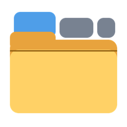
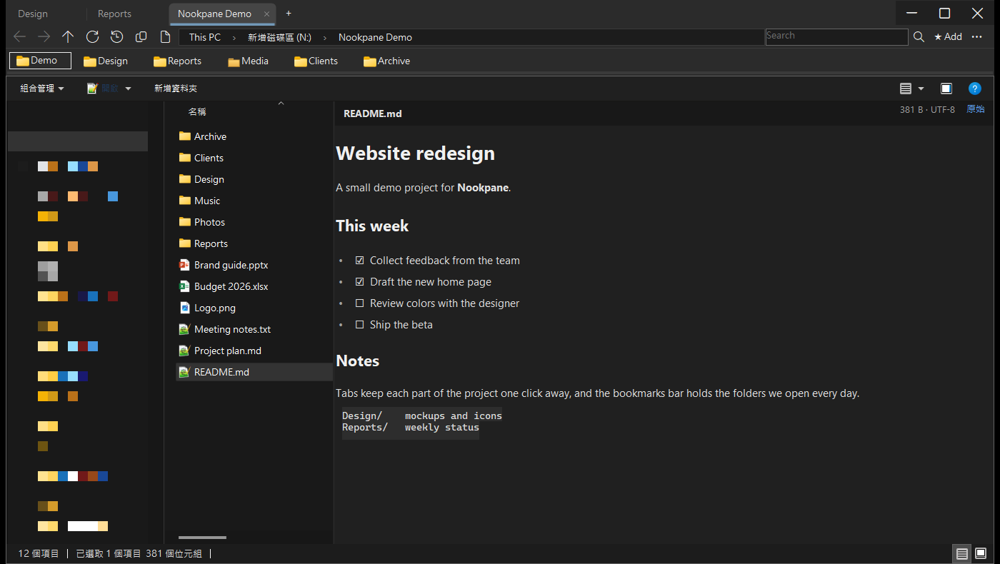

# Nookpane

**Tabs, bookmarks and history for Windows File Explorer — built on File Explorer itself.**

[**Download**](https://github.com/bemyselfstar/nookpane/releases/latest) ·
[Features](#features) ·
[Install](#install) ·
[FAQ](#faq) ·
[繁體中文](README.zh-TW.md)

by **bemyselfstar studio**

  

Tabs, a bookmarks bar, and a Markdown file in the preview pane. The file list is the real File Explorer view, so it follows your Windows language. (Navigation pane blurred.)

---

## Why Nookpane?

Most File Explorer replacements rebuild the file list from scratch, and something always behaves a little differently: a context menu entry is missing, drag and drop works almost the same, a cloud drive shows the wrong icons.

**Nookpane doesn't replace the file list.** Each tab hosts the real Windows File Explorer view, the same component File Explorer uses. Right-click menus, drag and drop, thumbnails, "Open with", OneDrive status icons and network drives all work exactly as you already know. Nookpane only adds what File Explorer is missing around it.

- **Feels native.** Your shell extensions, context menu items and keyboard habits keep working.
- **Lightweight.** One portable exe. No installer, no service, nothing running in the background when it's closed.
- **Your account only.** Never asks for administrator rights. Every setting it writes can be removed with one click.
- **Private.** No telemetry, no account, no ads. The only connection it makes is to GitHub, to check for updates.

## Features

### 🗂️ Tabs that behave like a browser
- `Ctrl+T` new tab, `Ctrl+W` close, `Ctrl+Tab` next, `Ctrl+1`–`9` jump to a tab.
- Drag tabs to reorder. **Drag a tab out** of the strip to make a new window; drag it onto another window to merge.
- Reopen the last closed tab with `Ctrl+Shift+T`. When there are too many tabs to fit, the ⌄ button lists all of them.
- **Restore windows** brings back every window and tab from your last session.

### ⭐ Bookmarks bar
- One click on **★ Add** bookmarks the current folder. Bookmarks can point to folders or files.
- Folders, drag to reorder, drop one bookmark onto another to make a folder.
- A **bookmark manager** with search, cut, copy and paste, plus **import and export** as JSON.

### 🕘 History
- Recent folders, recently opened files and recently closed tabs, one click away (`Ctrl+H` for the full list).
- Search the history by name or path.

### 📋 Copy paths properly
- Copy the current folder's path, or the paths of all selected items (`Ctrl+Shift+C`), one per line.
- Mapped network drives are copied as `\\server\share` paths that work for everyone. Shift-click to wrap each path in quotes; Alt-click to keep the drive letter.

### 🔍 Address bar and search
- A clickable breadcrumb address bar; click empty space to type a path.
- Search the current folder with the Windows index. Results include a **folder location** column.

### 👁️ File previews (optional)
In the preview pane (`Alt+P`), Nookpane can show files File Explorer can't:
- **Markdown**: rendered headings, lists, task lists, code blocks, and a raw-text tab.
- **Audio**: `mp3`, `wav`, `ogg` with a player.
- **PowerPoint** (`pptx`): slide titles, text and images, with arrow keys to flip.
- **Text-like files** with no preview of their own (`json`, `log`, `yaml`, `lua`, `cs`, `ps1`, `bat`…) use Windows' plain-text preview.

### 🛡️ Downloaded files and network drives
- When Windows blocks the preview of a file you downloaded, Nookpane tells you and offers to **unblock that one file**, only for file types it can preview. Programs, scripts and macro files are never unblocked.
- Network drives reached by IP address are treated as "Internet" by Windows, so their previews are blocked. Nookpane can add that server to your **Local intranet** list (private addresses only, your account only).

### 🏠 Make it your default (optional)
- **Set as default file manager**: double-clicking a folder or drive opens Nookpane. Switch it off any time, and right-click → **Open** always gives you File Explorer.
- **Take over File Explorer windows**: when a File Explorer window appears (`Win+E`, "Show in folder" from another app), Nookpane opens the same place, with the same files selected, and closes the File Explorer window.

### ✨ And
- Dark mode follows your Windows setting.
- Signed automatic updates: checked over HTTPS, verified with SHA-256 and a digital signature, and **never installed without your OK**.
- **Copy diagnostic info (hide personal info)** for bug reports: computer name, user name, servers, IP addresses and paths are replaced with placeholders.
- English and Traditional Chinese interface, chosen from your Windows display language.

## Nookpane vs. File Explorer

| | File Explorer | Nookpane |
|---|:---:|:---:|
| File list, context menus, drag and drop | ✅ | ✅ (the same component) |
| Tabs | ✅ (Windows 11) | ✅ + tear-off into new windows |
| Reopen closed tab, restore last session | — | ✅ |
| Bookmarks bar with folders | — (Quick access only) | ✅ |
| History of folders and files | — | ✅ |
| Copy paths of selected items, network drives as `\\server\share` | partial | ✅ |
| Preview Markdown, audio, PowerPoint | — | ✅ |
| Installation required | built in | ✅ none, portable |

## Requirements

- Windows 10 version 2004 (May 2020 Update) or later, or Windows 11.
- 64-bit (x64) PC.
- No installation and no administrator rights.
- File previews need the [.NET Desktop Runtime](https://dotnet.microsoft.com/download/dotnet) 8 or later. Everything else works without it.

## Install

1. Download a zip from the [**latest release**](https://github.com/bemyselfstar/nookpane/releases/latest):

   | | Full: `Nookpane.zip` (~75 MB) | Slim: `Nookpane-slim.zip` (~14 MB) |
   |---|---|---|
   | .NET included | ✅ nothing else to install | needs .NET Desktop Runtime 8+ |
   | Choose it if | you're not sure | you already have .NET, or a slow connection |

   *(Other zip files in a release are used by automatic updates. You don't need them.)*

2. Unzip the whole folder anywhere you can write to, for example `D:\Tools\Nookpane\`. Avoid `C:\Program Files\`: Nookpane writes its log file next to itself.
3. Run `Nookpane.exe`.

### "Windows protected your PC"

Nookpane isn't code-signed yet, so the first time you run it Windows SmartScreen may show a blue warning. This is normal for new programs from small developers:

1. Click **More info**.
2. Check that the app is `Nookpane.exe`.
3. Click **Run anyway**.

Some antivirus programs are wary of new programs that update themselves. If yours quarantines Nookpane, please [report it](#reporting-a-problem) so we can send a false-positive report to the vendor.

## Keyboard shortcuts

| Keys | Action |
|---|---|
| `Ctrl+T` / `Ctrl+W` (`Ctrl+F4`) | New tab / close tab |
| `Ctrl+Tab` / `Ctrl+Shift+Tab` | Next / previous tab |
| `Ctrl+1` … `Ctrl+9` | Jump to tab 1–9 |
| `Ctrl+Shift+T` | Reopen the last closed tab |
| `Ctrl+H` | History |
| `Alt+←` / `Alt+→` / `Alt+↑` | Back / forward / up |
| `F5` | Refresh |
| `Ctrl+Shift+C` | Copy paths of the selected items |
| `Ctrl+C` / `Ctrl+X` / `Ctrl+V` / `Ctrl+A` | Copy / cut / paste / select all files |
| `Alt+P` | Preview pane (File Explorer's own) |

## Command-line options

| Option | What it does |
|---|---|
| `Nookpane.exe "D:\Projects"` | Open a folder (in a new tab if Nookpane is already running) |
| `--new-window` | Open in a new window instead of a new tab |
| `--reset-window` | Bring the window back if it opens off-screen |
| `--classic-titlebar` | Use the standard Windows title bar |
| `--no-darkshell` | Don't apply dark mode to the file list |
| `--lang=en` / `--lang=zh-Hant` | Choose the interface language for this run |
| `--profile <name>` | Use a separate set of bookmarks and settings (for testing) |
| `--uninstall-all` | Remove every setting Nookpane wrote to this PC (see [Uninstall](#uninstall)) |

## Security and privacy

- **No telemetry.** Nookpane doesn't send usage data anywhere. It only contacts GitHub to check for and download updates.
- **Verified updates.** Updates come over HTTPS only. The update information is digitally signed (ECDSA P-256), and each package is checked against its SHA-256 before use. If either doesn't match, Nookpane refuses the update.
- **Downloaded-file protection stays on.** Nookpane never removes Windows' "downloaded from the internet" mark by itself. You decide, file by file, and only for previewable types.
- **Your account only.** All settings live under your user account (`HKEY_CURRENT_USER`). No administrator rights, no services, no drivers.

## Where your data lives

| | Location |
|---|---|
| Bookmarks, history, windows and tabs, settings | `%LOCALAPPDATA%\Nookpane\` |
| Log files | next to `Nookpane.exe` (`Nookpane-diagnostic.log` and two older ones) |

## Uninstall

1. In Nookpane, open **⋮** (top right) → **Remove all settings from this PC…**. This removes the preview handlers, the default-file-manager setting and the intranet settings, then closes Nookpane. Your bookmarks stay. If Nookpane won't start, run `Nookpane.exe --uninstall-all`.
2. Delete the Nookpane folder.
3. To remove your bookmarks and settings too, delete `%LOCALAPPDATA%\Nookpane\`.

Do step 1 first: if Nookpane is your default file manager and you only delete the folder, double-clicking folders stops working until you run step 1 from a fresh copy.

## FAQ

<b>Does Nookpane replace File Explorer?</b>

No. File Explorer stays exactly as it is. Nookpane is a separate window that hosts the File Explorer view inside tabs. You can use both, and you can make Nookpane the default for double-clicking folders if you like.

<b>Why are the file list and context menus in another language?</b>

They are File Explorer's own, so they always follow your Windows display language, whatever language Nookpane's own menus use.

<b>How do I get back to File Explorer for one folder?</b>

Right-click the folder → **Open**. That always opens File Explorer, even when Nookpane is the default.

<b>Why can't search highlight the matching words like File Explorer does?</b>

That highlighting is drawn by a newer part of File Explorer that other programs can't host. The search itself is the same Windows search.

<b>Is it free? Is it open source?</b>

It's free to use, including at work, and you may share unmodified copies. It's not open source. See the [license](LICENSE.txt).

## Known limitations

- Each tab still shows File Explorer's own command bar.
- Search results don't highlight matching words.
- `Win+E` can only be redirected through **Take over File Explorer windows**.
- Some dialogs are still in Chinese only; translation is in progress.

## Roadmap

- [x] Tabs, bookmarks, history, previews
- [x] Signed automatic updates
- [x] English interface: main window, menus, bookmarks
- [ ] English interface: all dialogs, plus a language switch in the ⋮ menu
- [ ] Code signing (no more SmartScreen warning)
- [ ] More preview types

## Reporting a problem

1. In Nookpane, open **⋮** → **Copy diagnostic info (hide personal info)**.
2. [Open an issue](https://github.com/bemyselfstar/nookpane/issues/new/choose) and paste it in. English or Chinese is fine.

Release notes for every version are on the [Releases](https://github.com/bemyselfstar/nookpane/releases) page.

## License

Nookpane is **freeware**: free to use (including commercially) and free to share unmodified. Not open source, no warranty. See [LICENSE](LICENSE.txt).

Built on the Windows Shell (`IExplorerBrowser`) and .NET. The full package includes the Microsoft .NET runtime, licensed separately under the MIT license.

Made by **bemyselfstar studio**

