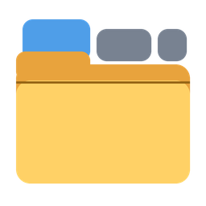
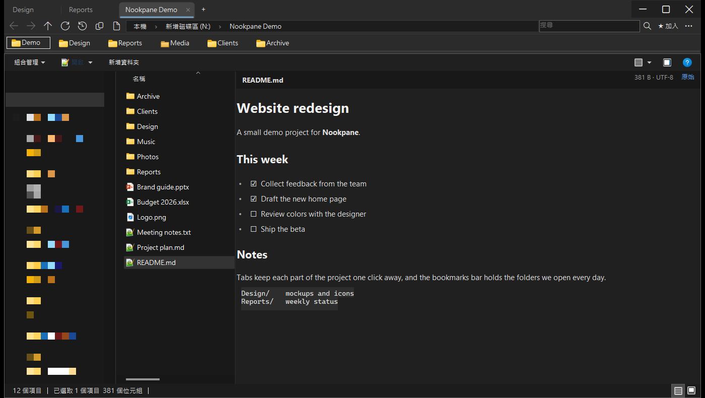

# Nookpane

**幫 Windows 檔案總管加上分頁、書籤和記錄 —— 核心就是檔案總管本身。**

[**下載**](https://github.com/bemyselfstar/nookpane/releases/latest) ·
[功能](#功能) ·
[安裝](#安裝) ·
[常見問題](#常見問題) ·
[English](README.md)

**bemyselfstar studio** 出品

  

分頁、書籤列，以及預覽窗格裡的 Markdown 檔。檔案清單是真正的檔案總管畫面。（左側導覽窗格已模糊處理）

---

## 為什麼選 Nookpane？

大部分「取代檔案總管」的軟體，檔案清單都是自己重寫的，總有地方跟檔案總管不一樣：右鍵少了某個選項、拖放差一點、雲端硬碟的圖示不對。

**Nookpane 不重寫檔案清單。** 每個分頁裡就是真正的 Windows 檔案總管畫面，跟檔案總管用的是同一個元件。右鍵選單、拖放、縮圖、「開啟方式」、OneDrive 狀態圖示、網路磁碟全部跟你熟悉的一樣。Nookpane 只在外面補上檔案總管缺的東西。

- **用起來就是原生的。** 你裝的右鍵外掛、選單項目、鍵盤習慣都照常。
- **輕巧。** 一個免安裝的 exe。沒有安裝程式、沒有服務，關掉之後背景什麼都沒有。
- **只動你自己的帳號。** 從不需要系統管理員權限，寫過的每一項設定都能一鍵拿掉。
- **重視隱私。** 不蒐集使用資料、不用帳號、沒有廣告。唯一會連線的是 GitHub，用來檢查更新。

## 功能

### 🗂️ 像瀏覽器一樣的分頁
- `Ctrl+T` 新增、`Ctrl+W` 關閉、`Ctrl+Tab` 下一個、`Ctrl+1`～`9` 直接跳。
- 拖曳排序；**把分頁拖出分頁列**就變成新視窗，拖到別的視窗就合併。
- `Ctrl+Shift+T` 重新打開剛關掉的分頁；分頁太多放不下時，⌄ 按鈕列出全部。
- **還原視窗**：把上次的所有視窗和分頁開回來。

### ⭐ 書籤列
- 按一下 **★ 加入** 就把目前的資料夾加成書籤；書籤可以指向資料夾或檔案。
- 可以分資料夾、拖曳排序，把一個書籤拖到另一個上面就合成一個資料夾。
- **書籤管理員**：搜尋、剪下、複製、貼上，還能**匯入、匯出**（JSON）。

### 🕘 記錄
- 最近的資料夾、最近開過的檔案、最近關閉的分頁，一鍵就到（`Ctrl+H` 看完整記錄）。
- 可以用名稱或路徑搜尋記錄。

### 📋 好用的複製路徑
- 複製目前資料夾的路徑，或所有選取項目的路徑（`Ctrl+Shift+C`），一行一個。
- 對應的網路磁碟會寫成大家都能用的 `\\伺服器\共用`。按住 Shift 點：每個路徑加引號；按住 Alt 點：保留磁碟機代號。

### 🔍 路徑列與搜尋
- 可以點的分層路徑列；點空白處就能直接輸入路徑。
- 用 Windows 索引搜尋目前資料夾，搜尋結果帶「檔案位置」欄。

### 👁️ 檔案預覽（選用）
在預覽窗格（`Alt+P`）顯示檔案總管預覽不了的檔案：
- **Markdown**：標題、清單、待辦清單、程式碼區塊都排好版，另有「原始」文字頁。
- **音訊**：`mp3`、`wav`、`ogg`，附播放器。
- **PowerPoint**（`pptx`）：每張投影片的標題、文字、圖片，用方向鍵翻頁。
- **文字類檔案**（`json`、`log`、`yaml`、`lua`、`cs`、`ps1`、`bat`…）沒有預覽時改用 Windows 的純文字預覽。

### 🛡️ 下載的檔案與網路磁碟
- Windows 擋住下載檔案的預覽時，Nookpane 會告訴你，讓你決定要不要**解除這一個檔的封鎖**，而且只限它能預覽的類型。執行檔、腳本、巨集檔一律不解除。
- 用 IP 連的網路磁碟會被 Windows 當成「網際網路」，預覽也會被擋。Nookpane 可以把那台伺服器加進「近端內部網路」（只收私有位址，只改你自己的帳號）。

### 🏠 設成預設（選用）
- **設為預設檔案管理員**：雙擊資料夾、磁碟機改用 Nookpane 開。隨時可以取消；右鍵 → **開啟** 永遠是檔案總管。
- **接手檔案總管視窗**：原生檔案總管一出現（`Win+E`、別的程式的「在資料夾中顯示」），就改在 Nookpane 開同一個位置、選回同樣的檔案，再關掉原生視窗。

### ✨ 還有
- 深色模式跟著 Windows 設定。
- 有簽章的自動更新：只走 HTTPS，用 SHA-256 和數位簽章驗證，**沒有你同意不會安裝**。
- 回報問題用的 **複製診斷資訊（隱藏個人資訊）**：電腦名稱、使用者名稱、伺服器、IP、路徑都換成代號。
- 介面有英文和繁體中文，跟著 Windows 顯示語言。

## 跟檔案總管比較

| | 檔案總管 | Nookpane |
|---|:---:|:---:|
| 檔案清單、右鍵選單、拖放 | ✅ | ✅（同一個元件） |
| 分頁 | ✅（Windows 11） | ✅ ＋ 可拖出成新視窗 |
| 重開關掉的分頁、還原上次的視窗 | — | ✅ |
| 可分資料夾的書籤列 | —（只有快速存取） | ✅ |
| 資料夾與檔案的記錄 | — | ✅ |
| 複製選取項目的路徑、網路磁碟寫成 `\\伺服器\共用` | 部分 | ✅ |
| 預覽 Markdown、音訊、PowerPoint | — | ✅ |
| 需要安裝 | 內建 | ✅ 不用，免安裝 |

## 系統需求

- Windows 10 2004 版（2020 年 5 月更新）以後，或 Windows 11。
- 64 位元（x64）電腦。
- 不用安裝，不需要系統管理員權限。
- 檔案預覽需要 [.NET 桌面執行階段](https://dotnet.microsoft.com/download/dotnet) 8 以後的版本；其他功能不需要。

## 安裝

1. 從[**最新版**](https://github.com/bemyselfstar/nookpane/releases/latest)下載 zip：

   | | 完整版 `Nookpane.zip`（約 75 MB） | 精簡版 `Nookpane-slim.zip`（約 14 MB） |
   |---|---|---|
   | 內含 .NET | ✅ 不用另外裝 | 要先裝 .NET 桌面執行階段 8 以後 |
   | 適合 | 不確定就選這個 | 已經有 .NET，或網路很慢 |

   *（每一版附的其他 zip 是給自動更新用的，你不用下載。）*

2. 把整個資料夾解壓縮到你有寫入權限的地方，例如 `D:\工具\Nookpane\`。不要放 `C:\Program Files\`：程式會在自己旁邊寫記錄檔。
3. 執行 `Nookpane.exe`。

### 出現「Windows 已保護您的電腦」

Nookpane 還沒有程式碼簽章，第一次執行時 Windows SmartScreen 可能會跳出藍色警告，小型開發者的新程式都會這樣：

1. 按 **其他資訊**。
2. 確認程式是 `Nookpane.exe`。
3. 按 **仍要執行**。

有些防毒軟體會懷疑「會自己更新的新程式」。如果 Nookpane 被隔離，請[回報](#回報問題)，我們會向防毒廠商申訴誤判。

## 快捷鍵

| 按鍵 | 功能 |
|---|---|
| `Ctrl+T` ／ `Ctrl+W`（`Ctrl+F4`） | 新增分頁／關閉分頁 |
| `Ctrl+Tab` ／ `Ctrl+Shift+Tab` | 下一個／上一個分頁 |
| `Ctrl+1` … `Ctrl+9` | 跳到第 1～9 個分頁 |
| `Ctrl+Shift+T` | 重新打開剛關掉的分頁 |
| `Ctrl+H` | 記錄 |
| `Alt+←` ／ `Alt+→` ／ `Alt+↑` | 上一頁／下一頁／上一層 |
| `F5` | 重新整理 |
| `Ctrl+Shift+C` | 複製選取項目的路徑 |
| `Ctrl+C` ／ `Ctrl+X` ／ `Ctrl+V` ／ `Ctrl+A` | 複製／剪下／貼上／全選檔案 |
| `Alt+P` | 預覽窗格（檔案總管原生的） |

## 命令列參數

| 參數 | 作用 |
|---|---|
| `Nookpane.exe "D:\專案"` | 開某個資料夾（Nookpane 已經開著就開在新分頁） |
| `--new-window` | 開在新視窗，不是新分頁 |
| `--reset-window` | 視窗跑到螢幕外面時，拉回來 |
| `--classic-titlebar` | 改用 Windows 標準標題列 |
| `--no-darkshell` | 檔案清單不套深色模式 |
| `--lang=en` ／ `--lang=zh-Hant` | 這次執行用哪種介面語言 |
| `--profile <名稱>` | 用另一份書籤和設定（測試用） |
| `--uninstall-all` | 拿掉 Nookpane 寫在這台電腦上的所有設定（見[移除](#移除)） |

## 安全與隱私

- **不蒐集使用資料。** 只連 GitHub 檢查、下載更新。
- **更新會驗證。** 只走 HTTPS；更新資訊有數位簽章（ECDSA P-256），每個套件使用前都比對 SHA-256，任何一項對不上就拒絕更新。
- **不關掉下載檔案的保護。** Nookpane 不會自己拿掉 Windows「從網路下載」的標記；要不要解除由你一個檔一個檔決定，而且只限能預覽的類型。
- **只動你自己的帳號。** 所有設定都在你的使用者帳號底下（`HKEY_CURRENT_USER`），不需要系統管理員、不裝服務、不裝驅動程式。

## 資料存在哪

| | 位置 |
|---|---|
| 書籤、記錄、視窗與分頁、設定 | `%LOCALAPPDATA%\Nookpane\` |
| 記錄檔 | `Nookpane.exe` 旁邊（`Nookpane-diagnostic.log` 和前兩次的） |

## 移除

1. 在 Nookpane 按右上角 **⋮** →「**移除這台電腦上的所有設定…**」。會拿掉預覽元件、預設檔案管理員、內部網路設定，然後關閉程式；書籤會保留。程式打不開的話，改執行 `Nookpane.exe --uninstall-all`。
2. 刪掉 Nookpane 的資料夾。
3. 連書籤和設定都不要的話，刪掉 `%LOCALAPPDATA%\Nookpane\`。

一定要先做第 1 步：Nookpane 是預設檔案管理員時直接刪資料夾，雙擊資料夾會失效，要再拿一份新的來做第 1 步才會恢復。

## 常見問題

<b>Nookpane 會取代檔案總管嗎？</b>

不會。檔案總管完全不變。Nookpane 是另一個視窗，在分頁裡放檔案總管的畫面。兩個可以一起用；想要的話，也可以把雙擊資料夾改成用 Nookpane 開。

<b>為什麼檔案清單和右鍵選單是另一種語言？</b>

那些是檔案總管自己的畫面，永遠跟著 Windows 顯示語言，跟 Nookpane 選單用哪種語言無關。

<b>某個資料夾想用檔案總管開，怎麼辦？</b>

在那個資料夾按右鍵 → **開啟**。就算 Nookpane 是預設，這樣開的永遠是檔案總管。

<b>為什麼搜尋結果沒有像檔案總管那樣把關鍵字標黃？</b>

那個標示是檔案總管較新的介面畫的，別的程式放不進來。搜尋本身是同一套 Windows 搜尋。

<b>要錢嗎？有開放原始碼嗎？</b>

免費使用（工作上用也可以），也可以把沒改過的程式免費分享給別人。不開放原始碼。詳見[授權條款](LICENSE.txt)。

## 已知限制

- 每個分頁上方仍會顯示檔案總管自己的命令列。
- 搜尋結果沒有關鍵字標示。
- `Win+E` 只能透過「接手檔案總管視窗」轉過來。
- 部分對話框還只有中文，英文翻譯進行中。

## 開發計畫

- [x] 分頁、書籤、記錄、預覽
- [x] 有簽章的自動更新
- [x] 英文介面：主視窗、選單、書籤
- [ ] 英文介面：所有對話框，⋮ 選單加語言切換
- [ ] 程式碼簽章（不再出現 SmartScreen 警告）
- [ ] 更多預覽格式

## 回報問題

1. 在 Nookpane 按 **⋮** →「**複製診斷資訊（隱藏個人資訊）**」。
2. [開一個 issue](https://github.com/bemyselfstar/nookpane/issues/new/choose)，把內容貼上。中文、英文都可以。

每一版的更新說明在 [Releases](https://github.com/bemyselfstar/nookpane/releases) 頁。

## 授權

Nookpane 是**免費軟體**：免費使用（包括商業用途），可以免費分享沒改過的程式。不開放原始碼，不提供保證。詳見 [LICENSE](LICENSE.txt)。

建立在 Windows Shell（`IExplorerBrowser`）與 .NET 之上。完整版內含 Microsoft .NET 執行階段，它另外以 MIT 授權提供。

**bemyselfstar studio** 出品

